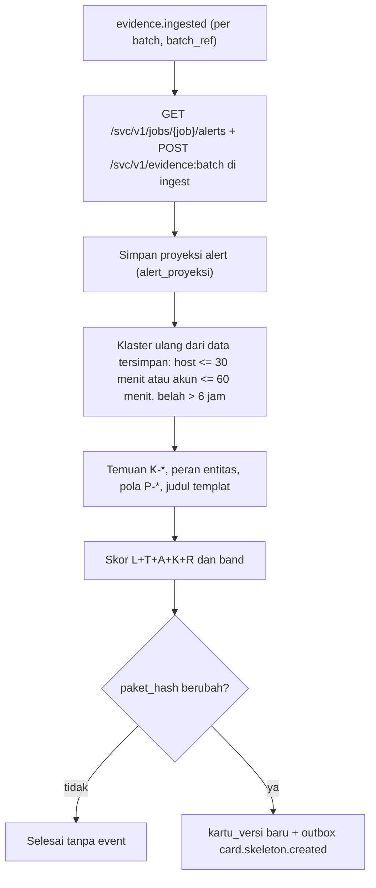

<!-- astria-logo -->
<p align="center">
  <picture>
    <source media="(prefers-color-scheme: dark)" srcset=".github/assets/astria-logo-reverse.svg">
    
  </picture>
</p>

# Astria triage

Mengubah alert yang disimpan `ingest` menjadi kerangka kartu insiden: klaster, temuan korelasi, peran entitas, pola, skor, dan band. Semuanya deterministik, tanpa model bahasa.

> Status: Tahap 1 (triage#3). Konsumen `evidence.ingested` menerbitkan `card.skeleton.created` lewat outbox. Repo ini adalah submodule dari workspace `triase-dfir` (folder `triage/`). Rancangan: `notes/2026-11-06-triase-dfir-app-triage.md` di repo root. Lajur developer: 1.

## Tech stack

Python 3.14, FastAPI, SQLAlchemy 2.1, PostgreSQL 18, NATS JetStream, orjson, uv. Uji: pytest, hypothesis, pyright.

## Perintah

```text
uv sync                                   # butuh akses ke repo privat contracts dan common (tag git)
uv run ruff format --check . && uv run ruff check . && uv run pyright
uv run pytest                             # uji DB dilewati tanpa ASTRIA_TEST_DATABASE_URL
sh ../common/template/localtest.sh        # di kontainer py devenv: uji terhadap salinan kerja common dan contracts
```

Menjalankan bersama layanan lain: `pwsh ../devenv/scripts/dev.ps1 up`, lalu `dev.ps1 smoke`.

## Cara kerja



- **Deterministik**: input sama + versi katalog + `algo_version` memberi `kode` dan `paket_hash` yang sama byte demi byte. Semua daftar diurutkan eksplisit, waktu diambil dari bukti (bukan jam sekarang), dan hash memakai JSON kanonik (orjson, kunci terurut). Diuji dengan urutan input acak (hypothesis) dan pembanding brute force untuk klaster.
- **Idempoten**: event yang sama ditahan `processed_events` (Consumer common). Batch yang datang lagi tidak membuat versi baru karena hash sama. ID event keluar deterministik (`uuid5(card_id, version)`), jadi relay ulang dibuang JetStream.
- **Versi kartu** naik hanya bila `paket_hash` berubah. Klaster yang menyatu dengan kartu lama memakai `card_id` lama. `card_id` = `IC-YYYYMMDD-NNN` (tanggal WIB awal klaster, UTC+7 tetap).
- **Bukti**: `kode.bukti[].sha256` = `record_sha256` dari ingest, yang dicocokkan verifier. Klaster sampai 200 alert memuat semua bukti. Klaster yang lebih besar memuat bukti rujukan dan satu wakil per aturan, maksimal 200.
- **Input tidak tepercaya**: `batch_ref` harus cocok pola `/svc/v1/jobs/ING-.../alerts?from=&to=`, dan host ingest selalu dari setting. Judul hanya diisi dari nilai peran (satu lintasan, tanpa `str.format`), lalu dipotong 200 karakter. Syarat pola adalah pohon JSON terbatas (`temuan`/`all`/`any`, tanpa `eval`).

### Skor

`skor = min(100, L + T + A + K + R)`. Band: `>= 70` KRITIS, `50-69` TINGGI, `30-49` SEDANG, `< 30` RENDAH.

| Faktor | Isi |
|---|---|
| L `level_aturan` | Level tertinggi: informational 0, low 5, medium 15, high 30, critical 40 |
| T `taktik_terjauh` | Bobot taktik paling lanjut (mis. credential-access 18, lateral-movement 22) |
| A `kritikalitas_aset` | Host di katalog aset; host tak terdaftar = sedang (5) + penanda |
| K `korelasi_taktik` | `min(10, 2 x jumlah taktik berbeda)` |
| R `pengulangan` | +5 bila host/akun sama sudah punya kartu SEDANG ke atas dalam 7 hari sebelum awal klaster; alasan menyebut kartu sumbernya |

Hasil pada data `samples` (diuji golden dan ujung ke ujung): riwayat `WS-ADM-04-brute-awal` **45 SEDANG** (`P-BRUTE-TANPA-AKSES`), rantai `svc-backup` **77 KRITIS** (`P-AKUN-DIAMBILALIH`; 72 tanpa kartu riwayat), jinak `J2` **10 RENDAH** (`P-UMUM`).

### Temuan korelasi

| Kode | Syarat |
|---|---|
| `K-LOGON-SUKSES-SETELAH-GAGAL` | Logon sukses (4624) akun sama <= 30 menit setelah >= 5 gagal (4625) dari IP yang sama |
| `K-BRUTE-TANPA-SUKSES` | >= 5 gagal dari IP sama ke akun sama dalam 30 menit, tanpa logon sukses akun itu sesudahnya |
| `K-AKUN-BARU-OLEH-AKUN-DIDUGA` | Akun dibuat (4720) atau dimasukkan ke grup (4732) oleh akun terbobol (`SubjectUserName`) |
| `K-PERSISTENSI-SETELAH-AKSES` | Alert bertaktik persistence di host yang sama setelah akses |
| `K-LOG-DIHAPUS-SETELAH-AKSES` | Log dihapus (1102) oleh akun terbobol setelah akses |

Teknik ATT&CK di `kode.teknik_attack` memakai ID kanonik v19 (`T1070.001` dipetakan ke `T1685.005`). Tag non-teknik seperti `S0039` dilewati.

### Katalog

`src/astria_triage/katalog/katalog.json` berisi taktik, bobot skor, aset, ambang korelasi, dan pola. File ini divalidasi Pydantic saat start, jadi katalog rusak membuat layanan gagal start. Tiap bagian punya `versi`, dan versinya ikut ke `catalog_version` di event. Katalog ini sementara sampai layanan `config` siap. Bobot adalah contoh awal; penyetelan lewat triage#5 dari hasil eval.

## Konfigurasi (env `ASTRIA_*`)

| Env | Bawaan | Isi |
|---|---|---|
| `ASTRIA_DATABASE_URL` | - | PostgreSQL milik triage |
| `ASTRIA_NATS_URL` | - | JetStream (konsumen `triage`, outbox) |
| `ASTRIA_SERVICE_KEY` atau `_FILE` | - | Wajib bila DB dan NATS diisi: token layanan untuk membaca ingest |
| `ASTRIA_TRIAGE_INGEST_URL` | `http://ingest:8000` | Basis URL ingest |

### Batasan yang diketahui

- Tabel dibuat dengan `create_all` (belum ada migrasi Alembic), sama dengan layanan lain.
- Panggilan ke ingest berjalan di dalam transaksi konsumen. Ini aman untuk data demo, tapi transaksi bisa lama untuk batch besar.
- Kartu lama tidak dihitung ulang bila kartu riwayat datang belakangan, jadi urutan impor memengaruhi faktor R. Impor riwayat dulu.
- Klaster disusun dari alert tersimpan dalam rentang 24 jam di sekitar batch; host/akun diperluas sampai 4 putaran untuk rantai transitif.
- Kartu lama yang menyatu ke kartu lain tidak ditutup lewat event (belum ada kontraknya); kartu itu tidak dipakai sebagai sumber R kartu gabungan.
- Galat data permanen (`batch_ref` tidak valid, bukti tidak dikembalikan ingest) tetap dicoba ulang oleh Consumer common sebelum masuk DLQ.
- Belum ada: dedup dan linimasa, endpoint reproses, `config.changed` dan status DITAHAN, metrik khusus triage, `audit.record` per kartu.

## Alur git

Branch `{type}/{yyyyMMdd}-{taskId}-{nama}`; commit `{type}({yyyyMMddHHmm}): [{taskId}] {pesan}`, satu baris, tanpa trailer. `main` hanya berubah lewat pull request (merge rebase); jangan push langsung ke `main` dan jangan `--no-verify`.
